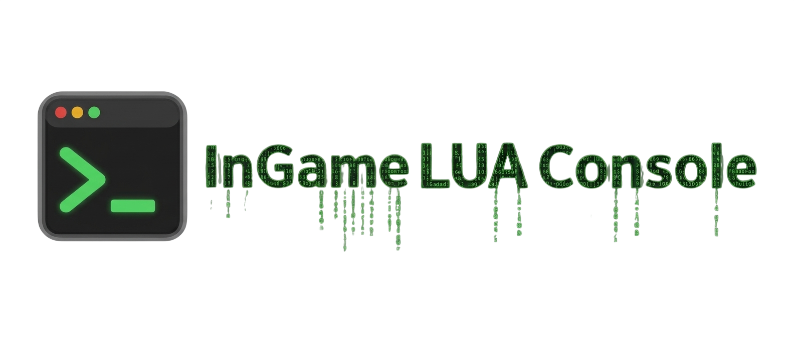
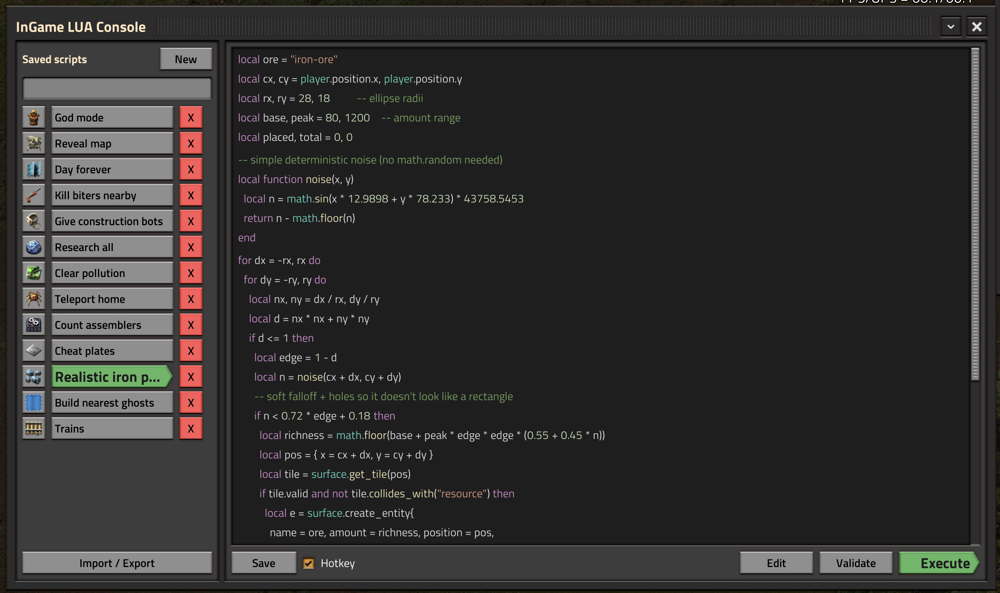
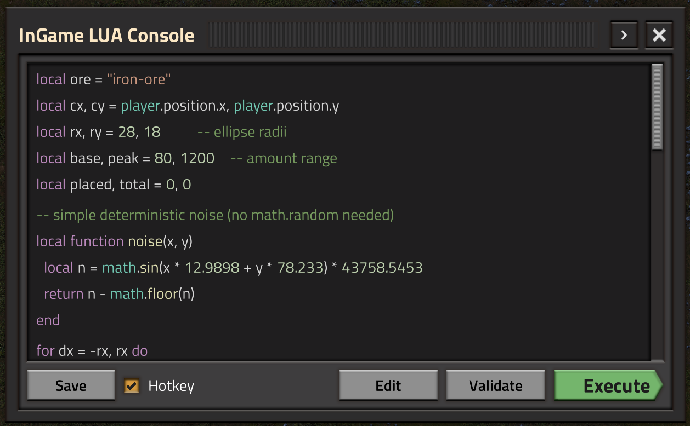
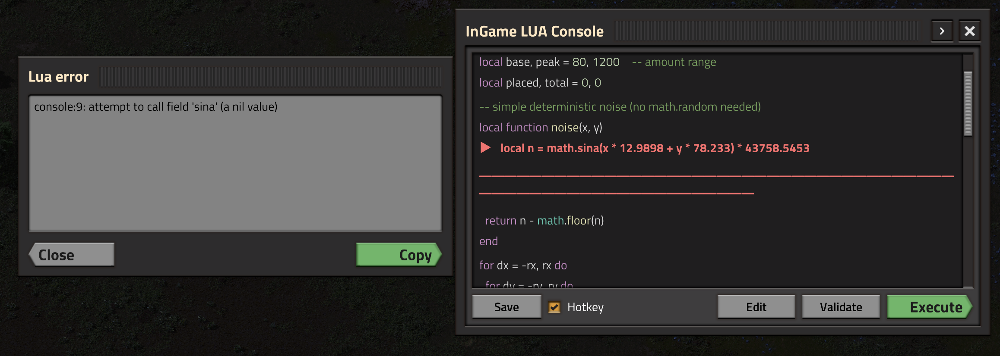

Write, preview, validate, save & execute Lua — without leaving Factorio

**GitHub:** https://github.com/patryk-sredzinski/InGame-LUA-Console

## Features

- Syntax-colored preview and validate-without-run
- Per-player script library (search, icons, import/export)
- Error line highlight + copyable error dialog
- Hotkey execute (`Ctrl+Enter`) and minimize mode
- Admin-only execute (like `/c`) with `player` / `game.player`

## Screenshots

  
  

## Controls

| | |
|---|---|
| Toggle | `Ctrl+Shift+L` · top-left button · `/luaconsole` |
| Execute | `Ctrl+Enter` (enable **Hotkey** in the console) |

  
**Tip:** only run code you trust. Execute has full admin Lua access.
